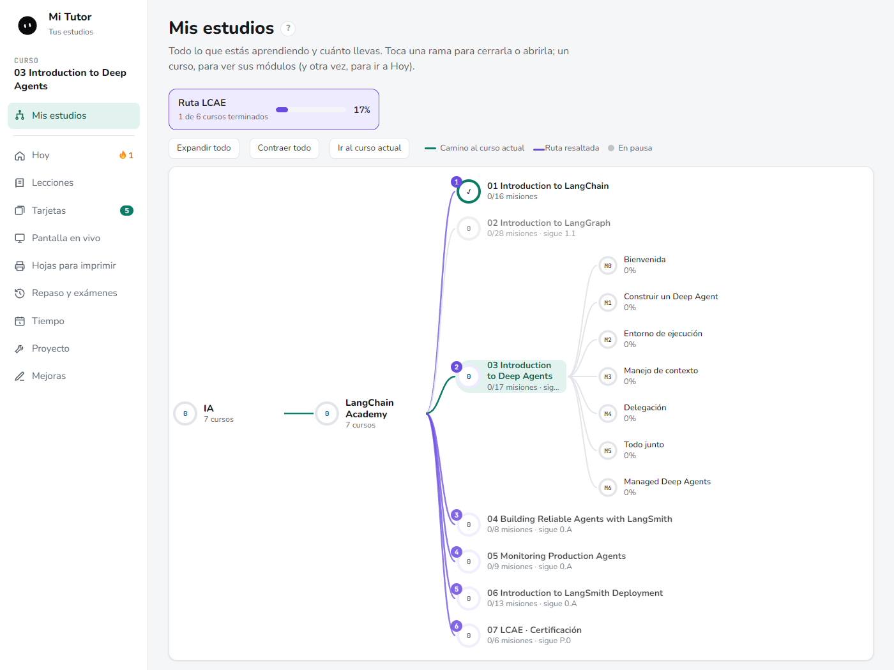
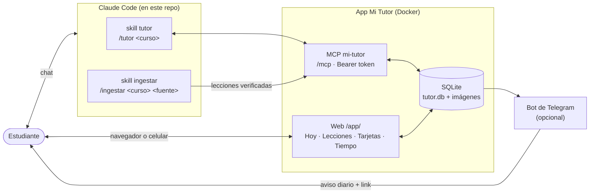
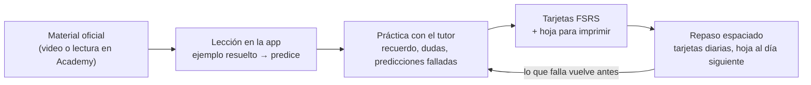
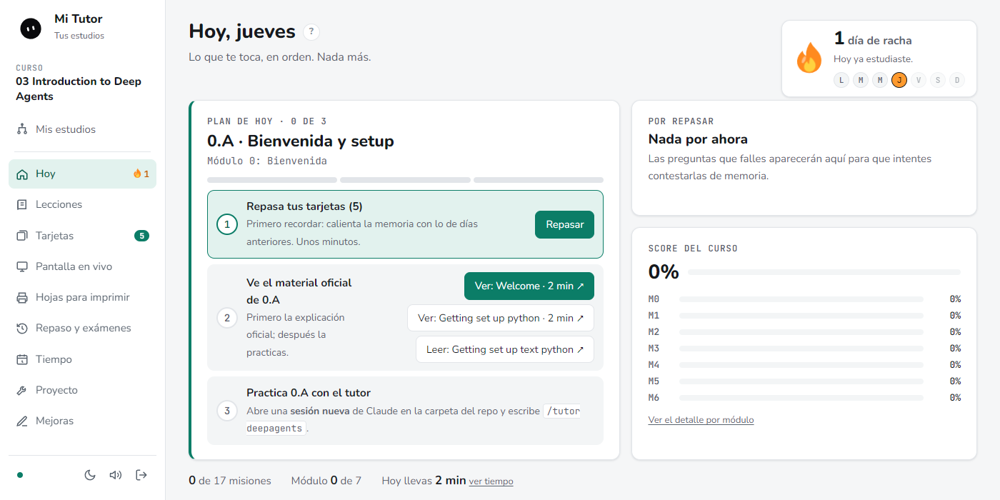
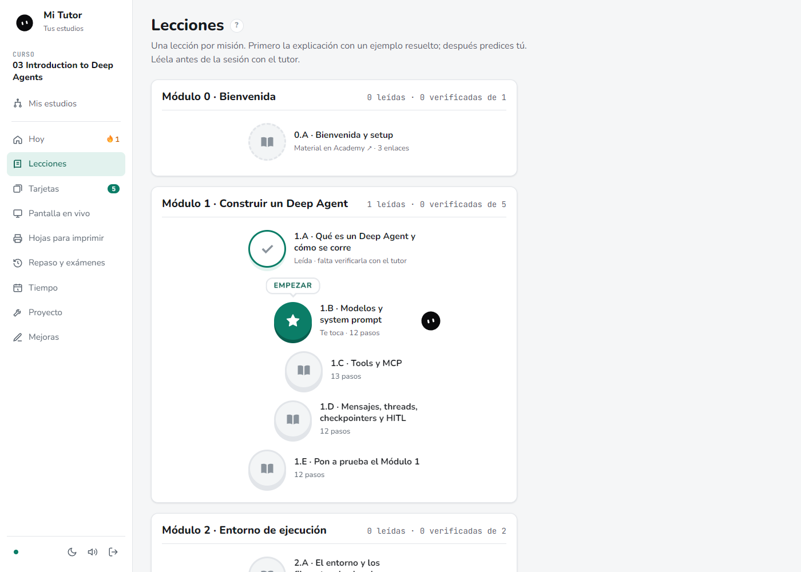
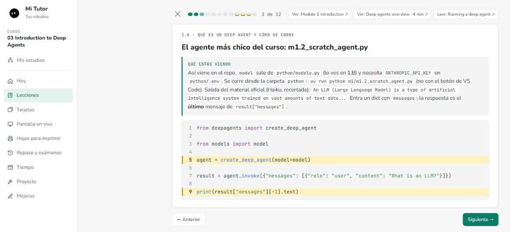
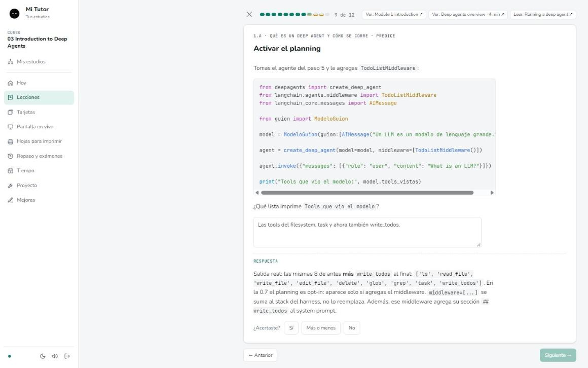
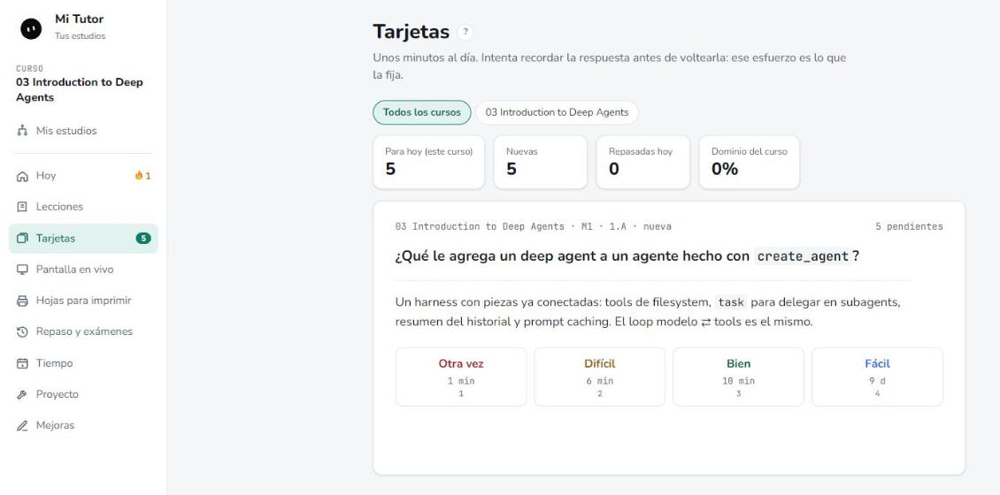
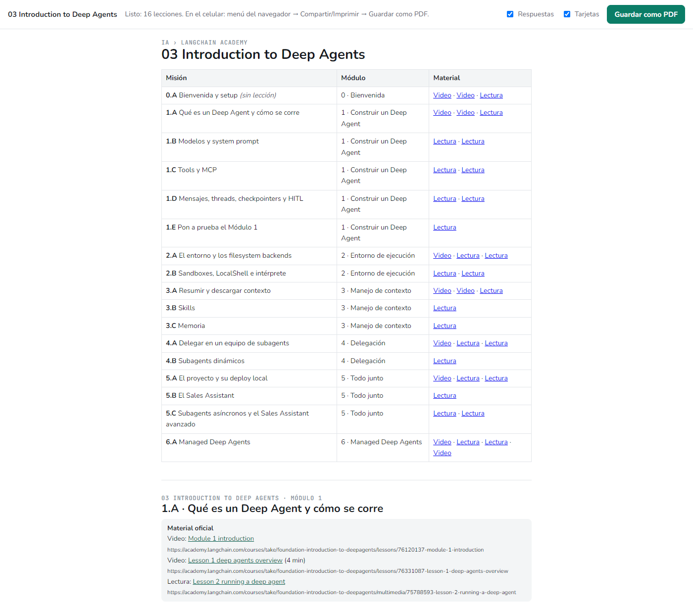
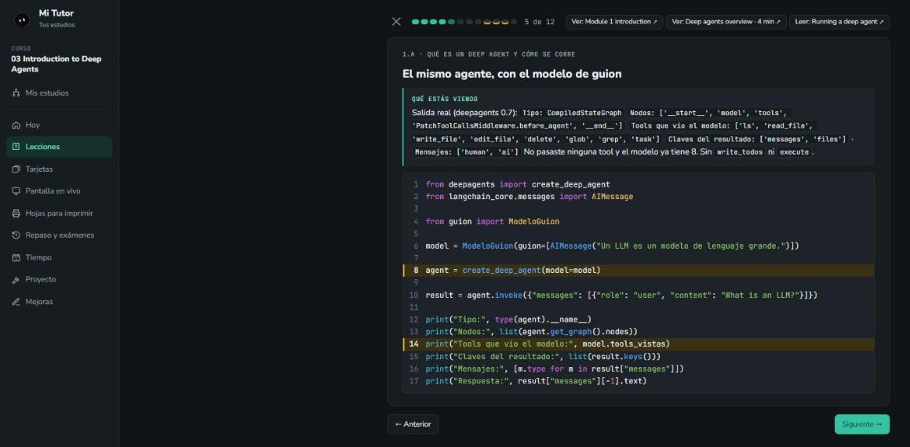

<p align="center">
  
</p>

<h1 align="center">Mi Tutor</h1>

<p align="center">
  App de estudio en la que <strong>Claude es el tutor</strong>: lecciones paso a paso, repaso espaciado,
  hojas para imprimir y un plan que te dice qué toca hoy.
</p>

<p align="center">
  
  
  
  
  
</p>

<p align="center">
  
</p>

- **Lecciones con ejemplo resuelto primero** y después pasos *predice*: hay que escribir la respuesta antes de verla.
- **Tarjetas de repaso espaciado (FSRS)** que entran solas al mazo al terminar cada lección.
- **Claude como tutor por MCP**: lee la lección, muestra código y diagramas en vivo y guarda tarjetas, hojas y progreso.
- **Mis estudios como grafo**, con rutas (por ejemplo la Ruta LCAE), score por módulo, tiempo y predicción de fin.
- **92 lecciones en español** de los cursos de LangChain Academy, listas para importar.

---

## Contenido

- [Qué es y para quién](#qué-es-y-para-quién)
- [Cómo funciona](#cómo-funciona)
- [Capturas](#capturas)
- [Empieza aquí: tu propia copia para estudiar](#empieza-aquí-tu-propia-copia-para-estudiar)
- [Contenido incluido](#contenido-incluido)
- [Por qué está hecha así](#por-qué-está-hecha-así)
- [Correr en local](#correr-en-local)
- [Producción](#producción)
- [Créditos](#créditos)

## Qué es y para quién

Mi Tutor nació de un problema concreto: los cursos en video aburren y no se quedan. La meta no es "terminar el
curso", sino **entender y recordar**. La app junta en un solo lugar lo que la evidencia dice que funciona
(práctica de recuerdo, repaso espaciado, ejemplos resueltos) y deja a Claude el papel de tutor, con reglas: no da la
respuesta de entrada, pide predicciones y mide sin ayuda.

Es para quien:

- estudia por su cuenta un curso técnico (hoy, la ruta de LangChain Academy hacia la certificación **LangChain
  Certified Agent Engineer**) y quiere un método, no solo videos;
- ya usa **Claude Code** y quiere que el tutor recuerde qué viste, qué fallaste y qué toca repasar;
- quiere estudiar también sin pantalla: hojas para imprimir y exportación a PDF por curso o rama.

La app **no lleva ningún modelo**. Claude es el tutor y la controla desde Claude Code a través del MCP `mi-tutor`.
Cada persona despliega **su propia copia**: su progreso y sus tarjetas son suyos.

## Cómo funciona

### Arquitectura



- **Web** (`/app/`): Starlette, con toda la interfaz en `app/static/index.html`. Login con link mágico de Telegram o
  `ADMIN_PASSWORD`.
- **MCP** (`/mcp`, Streamable HTTP, `Authorization: Bearer $MCP_TOKEN`): herramientas para leer el curso y la
  lección, mostrar paneles en vivo y guardar datos, hojas, tarjetas, lecciones, tiempo y mejoras.
- **Skills** en `.claude/skills/`: `tutor` (da misiones y enseña desde la lección) e `ingestar` (convierte material
  de un curso en lecciones, con el código verificado antes de publicarlo).
- **Telegram** (opcional): aviso diario con la imagen del plan de hoy (plan, racha, tiempo y predicción) y un
  recordatorio en la tarde si no has repasado. Comandos `/hoy`, `/tarjetas`, `/tiempo`, `/link`.

### El ciclo de una misión



1. **Material oficial.** Cada misión enlaza su video o lectura en LangChain Academy.
2. **Lección.** Explicación con un ejemplo resuelto y el código completo; después 2–4 pasos *predice* que se
   contestan por escrito para avanzar. Al terminarla queda *leída* y sus tarjetas entran al mazo.
3. **Práctica con el tutor.** Claude lee la lección y tus predicciones; si ya la leíste, empieza por lo que fallaste.
   Solo el tutor marca una lección como *verificada*, cuando contestas sin ayuda.
4. **Tarjetas y hoja.** Tarjetas de "entender" para el mazo FSRS y una hoja para resolver en papel al día siguiente.
5. **Repaso espaciado.** Unos minutos de tarjetas al día; lo que falla vuelve antes.

## Capturas

<table>
  <tr>
    <td width="50%" valign="top">
      
      <p><strong>Hoy.</strong> El plan del día en orden: tarjetas, material oficial, práctica con el tutor. Racha,
      lo que falta repasar y el score del curso por módulo.</p>
    </td>
    <td width="50%" valign="top">
      
      <p><strong>Lecciones.</strong> Camino por módulos con la que toca marcada. Cada módulo dice cuántas lecciones
      van leídas y cuántas verificadas.</p>
    </td>
  </tr>
  <tr>
    <td width="50%" valign="top">
      
      <p><strong>Visor de lecciones.</strong> Un concepto por paso, el código completo con las líneas clave
      resaltadas y la nota "qué estás viendo" junto al código. Arriba, los enlaces al material oficial.</p>
    </td>
    <td width="50%" valign="top">
      
      <p><strong>Paso <em>predice</em>.</strong> Escribes tu predicción con el código a la vista; después ves la
      salida real y dices si acertaste. El tutor empieza la sesión por lo que fallaste.</p>
    </td>
  </tr>
  <tr>
    <td width="50%" valign="top">
      
      <p><strong>Tarjetas.</strong> Repaso espaciado con FSRS: intentas recordar, volteas y calificas. Cada botón
      dice cuándo vuelve la tarjeta.</p>
    </td>
    <td width="50%" valign="top">
      
      <p><strong>Exportar a PDF.</strong> Cualquier rama o curso de Mis estudios se exporta con todas sus lecciones,
      las respuestas de los <em>predice</em> al final de cada una y sus tarjetas.</p>
    </td>
  </tr>
</table>

<p align="center">
  <br>
  <sub>Modo oscuro (botón de luna). El modo claro es el predeterminado.</sub>
</p>

Otras vistas: **Pantalla en vivo** (lo que el tutor muestra durante la sesión: código, diagramas, recorridos de un
grafo paso a paso, comparaciones), **Hojas para imprimir**, **Repaso y exámenes**, **Tiempo** (calendario, tiempo
hábil y predicción de fin por curso con rango del 80 %), **Proyecto** y **Mejoras** (errores y propuestas del
estudiante o del tutor).

## Empieza aquí: tu propia copia para estudiar

Cada persona tiene **su propia app** (su progreso y sus tarjetas son suyos). Para estudiar con el contenido de este
repo:

1. **Despliega la app** (Docker, por ejemplo en EasyPanel) desde este repo, con un volumen en `/data` y las
   variables `MCP_TOKEN` (una cadena larga y secreta que tú inventas), `ADMIN_PASSWORD` y `PUBLIC_URL`. Telegram es
   opcional. También corre en tu PC (ver [Correr en local](#correr-en-local)).
2. **Clona el repo** y crea `.venv` (ver [Correr en local](#correr-en-local)). Copia `.mcp.example.json` a
   `.mcp.json` y pon la URL de tu app (por ejemplo `https://tu-app.ejemplo.com/mcp`). Define la variable de entorno
   `MI_TUTOR_TOKEN` con el mismo valor que tu `MCP_TOKEN`.
3. **Carga el contenido** en tu app:

   ```bash
   MI_TUTOR_TOKEN=... .venv/Scripts/python tools/tutor_mcp.py importar contenido
   ```

   Carga el árbol de cursos, la Ruta LCAE, los planes, las misiones con links a LangChain Academy y las 92 lecciones.
4. **Inscríbete gratis** en los cursos de [LangChain Academy](https://academy.langchain.com) y clona sus repos
   (cada plan y la lección 0.A de cada curso dicen cuál). Para cada curso, pon su carpeta en `carpeta_local` del
   árbol (pídeselo al tutor).
5. Abre **Claude Code en esta carpeta** y escribe `/tutor deepagents` (o el curso que quieras). Si quieres, crea un
   `CLAUDE.local.md` con tu nombre, tu meta y tus carpetas: el tutor lo lee y no se sube a GitHub.

Si no puedes usar la app (por ejemplo, solo tienes el celular), entra a *Mis estudios* y usa el botón **PDF** de
cualquier rama o curso (`/app/exportar?nodo=<id>`).

## Contenido incluido

`contenido/` es una copia curada y **sin datos personales** (ni progreso, ni tarjetas repasadas, ni sesiones) de los
cursos de la ruta hacia la certificación **LangChain Certified Agent Engineer (LCAE)** y de Introduction to
LangGraph. Las lecciones son explicaciones propias en español, con código verificado, basadas en los cursos gratuitos
de LangChain Academy (código de ejemplo con licencia MIT); cada una enlaza su material oficial.

| Curso | ID | Lecciones | Dominio LCAE |
|---|---|---:|---|
| Introduction to LangChain | `langchain` | 16 | Build |
| Introduction to LangGraph | `langgraph` | 28 | Build (opcional, fuera de la ruta) |
| Introduction to Deep Agents | `deepagents` | 16 | Build |
| Building Reliable Agents with LangSmith | `reliable` | 8 | Test |
| Monitoring Production Agents | `monitoring` | 9 | Monitor |
| Introduction to LangSmith Deployment | `lsdeploy` | 13 | Deploy |
| LCAE: examen de práctica | `lcae` | 2 | Los cuatro |
| **Total** | | **92** | |

La **Ruta LCAE** (`contenido/rutas.json`) ordena los cursos: LangChain → Deep Agents → Reliable Agents → Monitoring →
LangSmith Deployment → examen. Mis estudios la resalta sobre el grafo con su progreso.

Para mantener la copia:

- `tools/tutor_mcp.py exportar contenido [--cursos a,b] [--pisar]`: regenera la copia desde tu app (no pisa lo
  curado salvo con `--pisar`).
- `tools/tutor_mcp.py importar contenido [--forzar]`: la carga en tu app (no toca cursos que ya tengan progreso
  salvo con `--forzar`).

Las lecciones nuevas se escriben con la skill `ingestar`: propone el temario, espera tu aprobación, corre el código
en el entorno del curso y sube las imágenes.

## Por qué está hecha así

**Lee [FILOSOFIA.md](FILOSOFIA.md)**: es la esencia de la app. La regla es que todo lo que hace tiene un *cómo* y un
*porqué* en estudios reales; lo que no tiene respaldo se marca como **hipótesis**. En resumen:

| Qué hace la app | Por qué | Fuente |
|---|---|---|
| Preguntas de memoria, pasos *predice*, tarjetas y hojas sin ver | La práctica de recuerdo es una de las dos técnicas de "alta utilidad" | Dunlosky et al. (2013) |
| Tarjetas FSRS diarias, hoja al día siguiente | El repaso espaciado es la otra técnica de alta utilidad | Dunlosky et al. (2013); Cepeda et al. (2006) |
| En un tema nuevo, primero el ejemplo resuelto y después predecir | La instrucción con poca guía rinde menos en novatos | Kirschner, Sweller y Clark (2006) |
| El tutor no da la respuesta de entrada; los exámenes son sin IA | Un chatbot sin reglas mejora la práctica pero baja el examen; con guardrails, el daño casi desaparece | Bastani et al. (2025) |
| Explicación junto al código, nada decorativo, un concepto por paso | Contigüidad, coherencia, señalización y segmentación | Mayer, *Multimedia Learning* |
| No se relee ni se subraya como método | Releer, subrayar y resumir salieron de baja utilidad | Dunlosky et al. (2013) |
| Predicción de fin con el ritmo real y un rango | Subestimamos cuánto tardamos (falacia de la planificación) | Buehler, Griffin y Ross (1994) |

Cada vista tiene un botón «?» que explica su razón de ser dentro de la app.

## Correr en local

```bash
uv venv --python 3.12 .venv && uv pip install --python .venv -r requirements.txt
DEV_NOAUTH=1 MCP_TOKEN=prueba PORT=3010 .venv/Scripts/python -m app.main
```

Abre `http://localhost:3010/app/`. `DEV_NOAUTH=1` entra sin login y es solo para local; para pruebas usa un
`DATA_DIR` aparte. Para que Claude Code hable con esta app, pon `http://localhost:3010/mcp` en tu `.mcp.json`.

## Producción

El `Dockerfile` levanta la app en el puerto **3000** con un volumen en **`/data`** (base SQLite `tutor.db` e imágenes
de las lecciones). Sirve cualquier plataforma que corra Docker; con EasyPanel basta un servicio *App* desde tu fork en
GitHub (rama `main`, Dockerfile) y un volumen montado en `/data`.

| Variable | Para qué |
|---|---|
| `MCP_TOKEN` | Token que Claude Code manda como `Authorization: Bearer ...` al MCP. Sin él, el MCP está apagado. |
| `ADMIN_PASSWORD` | (Opcional) Contraseña para entrar a la web sin link de Telegram. |
| `PUBLIC_URL` | URL pública de la app, para los links (por ejemplo `https://tu-app.ejemplo.com`). |
| `TELEGRAM_BOT_TOKEN`, `TELEGRAM_CHAT_ID` | (Opcional) Bot de Telegram. Solo responde a ese chat. |
| `AVISO_HORA`, `RECORDATORIO_HORA` | Aviso diario (08:00) y segundo aviso (19:00) si no has repasado. |
| `TZ_NAME` | Zona horaria (por defecto `America/Mexico_City`). |
| `DATA_DIR` | Carpeta de la base y las imágenes (en el contenedor, `/data`). |
| `IMAGEN_MAX_KB` | Tamaño máximo de una imagen subida (por defecto 1500). |

La lista completa está en el encabezado de `app/main.py`.

## Créditos

- El material de las lecciones se basa en los cursos gratuitos de [LangChain Academy](https://academy.langchain.com).
  Las lecciones son explicaciones propias y cada una enlaza su fuente; **quien estudie debe inscribirse allá** para
  ver los videos, las lecturas y el código oficial.
- El grokpet usa el motor de animación de [bloub](https://github.com/jeremy-prt/bloub) (MIT © 2026 Jérémy Perret),
  ver `app/static/BLOUB-LICENSE.txt`.
- Tipografía Nunito (SIL Open Font License), en `app/static/fuentes/`.
